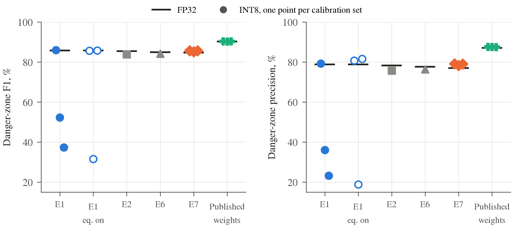

%% Manuscript for AUT Journal of Electrical Engineering (EEJ). Build: third_party/.venv-docx/bin/python tools/build_eej_docx.py
%% Syntax (tools/build_eej_docx.py): "# " / "## " / "### " headings (auto-numbered 1-, 1-1-, 1-1-1-; "{-}" = unnumbered),
%% **bold**, *italic*, ^sup^, ~sub~, [@key; @key2] citations (numbered by first appearance), @tab:x / @fig:x / @eq:x
%% cross-references, [TBD: ...] placeholders (red), "$$ latex $$ {#eq:x}" display equations, "Table: caption {#tab:x}" +
%% pipe table, "{#fig:x}" figures, "%ref key | text" reference entries (EEJ/EndNote style).
%% Every number traces to results/ or docs/data/ (see paper/main.tex source comments).

%title: Real-Time Maritime Obstacle Segmentation for Low-Cost Unmanned Surface Vehicles on an Edge Neural Accelerator
%authors: [TBD: First author]^1^, [TBD: Second author]^2,*^
%affil: 1 | [TBD: Scientific degree, faculty, university, city, country]
%affil: 2 | [TBD: Scientific degree, faculty, university, city, country]
%corresponding: [TBD: corresponding author's email]
%keywords: Unmanned surface vehicle, Obstacle segmentation, Edge computing, Post-training quantization, Neural network accelerator

%abstract: Small unmanned surface vehicles must detect obstacles in real time on inexpensive on-board hardware, including obstacle types never seen during training. Segmentation networks meet the second requirement by labelling every pixel as water, sky or obstacle, but their behaviour on low-cost dataflow accelerators has not been studied. This paper deploys a state-of-the-art embedded maritime segmentation network on a Raspberry Pi 5 with a Hailo-8L accelerator and shows that its speed is limited not by unsupported operations but by how often the compiled network must be swapped through the on-chip memory. The swaps are caused by the channel multilayer perceptrons of the feature mixer: the published weights have silenced five of the six, whereas they remain active whenever the network is retrained. Removing them structurally reduces the parameters by 61% and halves the number of swaps. On the device, the resulting network is 59% to 70% faster than the original network trained with the same recipe, reaching 29.7 frames per second on the accelerator and 22.7 frames per second end-to-end, with unchanged accuracy on a public maritime benchmark over three training runs. It is also robust to 8-bit post-training quantization: across three calibration sets its danger-zone F1 score stays between 85.1% and 85.7%, whereas that of the original network drops to as low as 37%, a failure that pixel agreement with the floating-point model does not reveal. When both networks are retrained on river scenes, the speed advantage remains, which makes the proposed network a practical choice for low-cost vessels.

# Introduction

Unmanned surface vehicles (USVs) are increasingly used for water-quality monitoring, hydrographic surveys and waste collection on rivers, lakes and coastal waters. To navigate autonomously, a USV must detect the obstacles it has to avoid, from boats and piers to small buoys, using hardware that fits the cost and power budget of a small vessel. This paper addresses the perception part of this problem: from a single camera image, the system must report the obstacles on the water surface and their bearings, to be consumed by a separate path planner.

Early camera-based approaches for USVs modelled the water surface with hand-crafted features and graphical models [@kristan2016fast; @prasad2017survey]. Deep learning changed the field in two directions. Object detectors such as YOLO [@redmon2016yolo] are fast and widely supported by edge toolchains, but they report only the classes they were trained on, while a vessel must avoid anything that floats in its path. Semantic segmentation networks [@long2015fcn; @chen2018deeplab] instead label every pixel; in the maritime domain, WaSR [@bovcon2022wasr] labels each pixel as *water*, *sky* or *obstacle*, so that every region that is neither water nor sky is treated as an obstacle, including object types absent from the training data. WaSR was trained on the MaSTr1325 dataset [@bovcon2019mastr], evaluated on the MODS benchmark [@bovcon2022mods], and later extended with temporal context [@zust2022temporal]. Its embedded successor eWaSR [@tersek2023ewasr] replaces the heavy ResNet-101 encoder with ResNet-18 [@he2016resnet] and a lightweight token-based decoder [@zhang2022topformer; @yu2022metaformer]; it runs ten times faster than WaSR on a desktop GPU and at 5.5 frames per second (FPS) on an OAK-D device [@tersek2023ewasr].

Two questions remain open for low-cost USVs. First, eWaSR was designed for the Myriad X vision processor of the OAK-D. It has not been studied on dataflow accelerators such as the Hailo-8L (13 tera-operations per second), which is now available as an add-on for the Raspberry Pi 5 and imposes its own constraints on the supported operations, on static tensor shapes and on the on-chip memory. Second, such accelerators compute in 8-bit integers (INT8), so the network must be quantized after training with a small set of calibration images [@jacob2018quantization; @krishnamoorthi2018quantizing; @nagel2021white]. Whether the resulting accuracy is stable, in particular for obstacles close to the vessel, has not been reported.

This paper answers both questions with a controlled study on a Raspberry Pi 5 with a Hailo-8L. We show that the speed of eWaSR on this accelerator is set mainly by the number of *contexts*, i.e. how many times the compiled network must be swapped in and out of the on-chip memory for each frame, and that the contexts are caused by the channel multilayer perceptrons (MLPs) of the feature mixer. In the published eWaSR weights five of the six MLPs have been silenced by training, so the compiler can drop them; when the network is retrained, as is necessary for any new operating area, they remain active and double the number of contexts. We therefore propose eWaSR-Lite, which removes these MLPs structurally and replaces the channel-reducing spatial attention with a depthwise gate. Fig. @fig:tradeoff summarizes the outcome on the device: eWaSR-Lite is the fastest network and keeps its accuracy with every calibration set, whereas the original network is slower and its accuracy collapses with two of three calibration sets. The contributions are:

{#fig:tradeoff}

1. eWaSR-Lite, a variant of eWaSR for low-cost dataflow accelerators. In a controlled 2×2 study (two spatial mixers, full or reduced MLPs, one quantization protocol), removing the MLPs reduces the parameters by 61% and the contexts from 8 to 4 and raises the accelerator throughput by 49% to 86%, without loss of accuracy on MODS beyond the run-to-run spread of three training runs.
2. An INT8 robustness study on the device with the official MODS toolkit, which shows that the quantized accuracy of eWaSR depends strongly on the calibration set, through false obstacles in front of the vessel, while eWaSR-Lite is stable; pixel agreement between the INT8 and the floating-point masks, a common sanity check, does not reveal these failures.
3. A study of retraining on river scenes (LaRS [@zust2023lars]), which shows that the false alarms caused by reflections drop sharply and that the speed advantage of eWaSR-Lite remains (8 versus 4 contexts), together with an open-source pipeline from training to on-device inference. The code, the trained weights and all measured results are available at https://github.com/huyhau0504-cmd/ewasr-lite.

The rest of the paper is organized as follows. Section 2 reviews related work. Section 3 describes the constraints of the accelerator, the proposed network and the on-device pipeline. Section 4 presents the experimental setup. Section 5 reports and discusses the results on accuracy, speed, quantization and river scenes, together with the limitations of the study, and Section 6 concludes the paper.

# Related Work

## Maritime obstacle detection

Maritime obstacle detection has moved from hand-crafted water models [@kristan2016fast; @prasad2017survey] to deep segmentation networks. WaSR [@bovcon2022wasr] combines a ResNet-101 encoder with atrous convolutions [@chen2018deeplab] and a decoder with attention refinement modules [@yu2018bisenet], and is trained with a focal loss [@lin2017focal] and a water-obstacle separation loss that pulls water features together and pushes obstacle features away from them. eWaSR [@tersek2023ewasr] keeps this loss but uses ResNet-18 and a TopFormer-style [@zhang2022topformer] decoder, in which MetaFormer blocks [@yu2022metaformer] operate on a small pyramid of pooled tokens and semantic injection modules re-inject global context into each scale. MaSTr1325 [@bovcon2019mastr] is the standard training set; MODS [@bovcon2022mods] provides an evaluation protocol based on obstacles and the water edge, with a danger zone around the vessel; LaRS [@zust2023lars] extends training and evaluation to lakes, rivers and seas.

## Efficient segmentation and quantization

Real-time segmentation networks reduce computation with depthwise-separable convolutions [@sandler2018mobilenetv2], with separate paths for spatial detail and context [@yu2018bisenet; @poudel2019fastscnn], or by computing global context on a coarse token grid [@zhang2022topformer]. Most of them are designed for mobile GPUs or CPUs, where the number of operations is a good proxy for latency. On a fixed-function INT8 accelerator, operator support and on-chip memory matter more. INT8 inference relies on post-training quantization (PTQ) or quantization-aware training [@jacob2018quantization; @krishnamoorthi2018quantizing; @wu2020integer; @nagel2021white]. PTQ estimates the value range of every layer from a small calibration set, and toolchains such as the Hailo Dataflow Compiler [@hailo_dfc] add techniques such as cross-layer equalization [@nagel2019dfq], which rescales consecutive layers so that their weights quantize better. Maritime work reports quantized results for a single calibration [@tersek2023ewasr]; we are not aware of a study of calibration-set sensitivity for maritime segmentation. [TBD: verify this statement against recent literature]

# Method

## Why the number of contexts limits speed on the Hailo-8L

The Hailo-8L executes a compiled dataflow graph with static tensor shapes in INT8. The compiler maps each layer to on-chip compute and memory resources; layers that cannot be mapped must run on the host CPU, which splits the network and adds transfers over the PCIe link. When the weights and intermediate tensors of the whole network do not fit on the chip at once, the compiler partitions the network into several *contexts* that are loaded one after another for every frame. Each switch costs time, so the throughput falls as the number of contexts grows. With the Hailo Dataflow Compiler (DFC) 3.34, the original eWaSR, including the channel-wise reductions of its spatial attention, compiles and runs entirely on the accelerator; its speed is limited by the number of contexts instead (Section 5-2), and this number depends on how many feature-mixer MLPs are active.

## From eWaSR to eWaSR-Lite: removing the silenced MLPs

Fig. @fig:arch shows the architecture. We keep the ResNet-18 encoder of eWaSR without its optional inertial input, the pyramid pooling of the four encoder stages (strides 4 to 32) to a token grid of 6×8 for a 384×512 input (960 channels), the feature mixer of six MetaFormer blocks operating on these tokens, the enricher of two MetaFormer blocks on the stride-8 features, and the four semantic injection modules that combine the global tokens with the local features. Each MetaFormer block computes

$$ x \leftarrow x + \gamma_1 \odot \mathrm{Mixer}(\mathrm{BN}(x)) $$ {#eq:mf1}

$$ x \leftarrow x + \gamma_2 \odot \mathrm{MLP}(\mathrm{BN}(x)) $$ {#eq:mf2}

in which *x* is the token tensor, BN is batch normalization, ⊙ is the element-wise product, and *γ*~1~ and *γ*~2~ are learnable per-channel layer scales [@touvron2021cait] initialized to 10^−5^. A layer scale close to zero switches its branch off. eWaSR uses two token mixers of the form *y* = *A*(*x*) ⊙ *x*: a channel mixer C, which is an attention refinement module [@yu2018bisenet] that computes one weight per channel from the globally pooled features, and a spatial mixer S,

$$ A_S(x) = \sigma\left(k * \left[\mathrm{mean}_c\, x;\ \max_c\, x\right]\right) $$ {#eq:as}

in which σ is the sigmoid function, *k* is a 3×3 convolution kernel, and the mean and maximum are taken over the channel axis *c*. eWaSR uses the mixer sequence CCCCSS and an SS enricher.

{#fig:arch}

**Silenced MLPs.** Each feature-mixer MLP maps 960 to 3840 channels and back (7.4 M parameters), so the six MLPs hold 44.3 M of the 60.3 M parameters of eWaSR. In the published eWaSR weights [@tersek2023ewasr], the mean |*γ*~2~| of blocks 1 to 5 is about 3.6×10^−40^, a denormal value, and only the MLP of block 0 contributes to the output (Fig. @fig:gamma). After quantization these branches are exactly zero and the compiled network no longer depends on them: with the published weights, the full network and the network with the MLPs removed produce bit-identical INT8 masks on all 8175 MODS frames. When we train eWaSR from an ImageNet-initialized encoder (Section 3-3), the layer scales do not vanish. In each of three training runs one block shrinks to between 10^−8^ and 10^−13^ (block 3 in two runs, block 4 in the third), while the others stay between 2.5×10^−4^ and 1.2×10^−2^. Retraining with the training recipe reported for eWaSR (Section 5-5) keeps all six layer scales between 1.1×10^−2^ and 1.7×10^−2^. None of these values is zero, so all MLPs remain in the compiled graph and the network needs 8 contexts instead of 4 (Section 5-2).

![Layer scale of the MLP branch (mean |γ~2~| over channels, logarithmic axis) per feature-mixer block, for the published eWaSR weights [@tersek2023ewasr], three runs of eWaSR trained from ImageNet with our recipe (E1) and one run with the original eWaSR recipe. The published weights silence blocks 1–5 to about 10^−40^; in our runs one block shrinks to 10^−8^–10^−13^ and the others stay active, and with the original recipe all six stay active.](../figs/gamma.png){#fig:gamma}

**Reduced MLPs.** We remove the MLP branch, together with its normalization and layer scale, from feature-mixer blocks 1 to 5, and keep it in block 0 and in the enricher. This removes 36.9 M parameters and 1.77 GMAC (Table @tab:arch). Loaded with the published eWaSR weights, the reduced network produces exactly the same logits as eWaSR, so the change makes explicit what the original training had converged to, and it makes the compact graph independent of the training recipe.

**Depthwise spatial gate (D).** The spatial mixer S reduces along the channel axis, an operation that many accelerators support poorly. We replace it with a gate that uses only convolution, batch normalization and the sigmoid function:

$$ A_D(x) = \sigma\left(\sum_c w_c\, \mathrm{BN}(k_c * x_c) + b\right) $$ {#eq:ad}

in which *k*~*c*~ is a 3×3 depthwise kernel of channel *c*, *w*~*c*~ and *b* are the weights and bias of a 1×1 convolution to a single channel. D keeps the role of S, a single spatial gate shared by all channels, but replaces the fixed mean and maximum over channels with a learned linear combination; it contains the mean branch of S as a special case (*w*~*c*~ = 1/*C* and identity kernels). The mixer sequence becomes CCCCDD with a DD enricher.

**eWaSR-Lite** combines both changes (CCCCDD mixer with an MLP only in block 0, DD enricher; 23.38 M parameters, 10.23 GMAC). We report the four combinations as eWaSR (E1), eWaSR with the D mixer (E2), eWaSR-Lite with the S mixer (E6) and eWaSR-Lite (E7).

Table: Architecture statistics at a 384×512 input. GMAC: giga multiply-accumulate operations; Reduce: channel-wise ReduceMax/ReduceMean operations in the exported graph (feature mixer / enricher). {#tab:arch}
| Model | Mixer / enricher | Parameters | GMAC | Reduce |
|---|---|---|---|---|
| eWaSR (E1) | CCCCSS / SS | 60.25 M | 11.99 | 4 / 4 |
| eWaSR, D mixer (E2) | CCCCDD / DD | 60.28 M | 11.99 | 0 / 0 |
| eWaSR-Lite, S mixer (E6) | CCCCSS / SS | 23.35 M | 10.22 | 4 / 4 |
| **eWaSR-Lite (E7)** | CCCCDD / DD | 23.38 M | 10.23 | 0 / 0 |

**Accelerator-friendly resampling and pre-processing.** All internal resampling uses integer scale factors and pooling uses fixed kernels instead of adaptive pooling, so the exported graph has static shapes; the input height and width must be multiples of 32. The network outputs three-class logits at a quarter of the input resolution; bilinear upsampling to the image resolution and the arg-max run on the host. The ImageNet normalization is folded into the accelerator, so the host sends raw 8-bit RGB frames, which removes a floating-point conversion on the CPU and quarters the input transfer size.

## Training

We follow the loss and optimizer of eWaSR [@tersek2023ewasr; @bovcon2022wasr]. The loss is

$$ \mathcal{L} = \mathcal{L}_{\mathrm{focal}} + \lambda\, \mathcal{L}_{\mathrm{sep}} $$ {#eq:loss}

with λ = 0.01. The focal loss [@lin2017focal] with focusing parameter 2 is computed after bilinear upsampling of the logits to the label resolution; pixels labelled *unknown* in MaSTr1325 and border pixels introduced by geometric augmentation do not contribute. The separation loss is applied to the stride-16 encoder features *f*:

$$ \mathcal{L}_{\mathrm{sep}} = \mathrm{mean}_c \frac{N_o\, \sigma^2_{w,c}}{\sum_{i \in O} (f_{i,c} - \mu_{w,c})^2 + \varepsilon} $$ {#eq:sep}

in which *μ*~*w*~ and *σ*^2^~*w*~ are the mean and variance of the water features in the batch, *O* is the set of obstacle pixels, *N*~*o*~ = |*O*| and ε = 0.01. We use RMSprop (momentum 0.9, smoothing constant 0.9, weight decay 10^−6^) with learning rates of 10^−6^ for the encoder, 10^−5^ for the decoder weights and 2×10^−5^ for the decoder biases and layer scales, and a polynomial decay with power 0.9 per epoch. Augmentation follows the eWaSR code (horizontal flip, affine shift, scale and rotation, colour jitter and noise). Every model is trained from an ImageNet-pretrained ResNet-18 [@he2016resnet] for 100 epochs with batch size 4 and mixed precision on one NVIDIA T4 GPU, and we keep the checkpoint with the highest mean intersection-over-union on the validation split. The eWaSR paper trains with batch size 16 for up to 200 epochs with early stopping [@tersek2023ewasr]; we use the shorter schedule for all variants so that they are compared under one recipe within our compute budget.

## On-device pipeline

On the Raspberry Pi 5, each frame is resized to the network input, inferred on the Hailo-8L through the HailoRT runtime, upsampled on the CPU and post-processed. The largest water region touching the bottom of the image defines the raw water edge, i.e. the topmost water pixel in each column. An obstacle in front of the shore is connected to the shore in the image and makes the raw edge dip below it; we therefore smooth the edge profile with a one-dimensional morphological opening whose width is 20% of the image width. Obstacle pixels below the smoothed edge form connected components; components of at least 20 pixels are reported with a bounding box and a bearing (*x*~*b*~/*W* − 0.5)·*HFOV*, where *x*~*b*~ is the horizontal position of the lowest point of the component, *W* the image width and *HFOV* the horizontal field of view of the camera. Frame reading, inference and post-processing run concurrently in a reader thread, an inference thread and two post-processing processes. The accuracy results below are computed on the network output masks.

# Experimental Setup

## Data and evaluation

All models in Sections 5-1 to 5-3 are trained on MaSTr1325 [@bovcon2019mastr] at 384×512 with the 1299/26 train/validation split of the eWaSR repository. eWaSR and eWaSR-Lite are trained three times each (seeds 0 to 2) to measure the run-to-run spread; the two other variants once. For Section 5-4, eWaSR and eWaSR-Lite are additionally trained on the LaRS training set [@zust2023lars] (2605 images, 1323 of which are relabelled MaSTr1325 images) and validated on the LaRS validation set.

We evaluate on all 94 sequences (8175 frames) of MODS [@bovcon2022mods] with the official toolkit [@mods_toolkit] and its default thresholds: an obstacle counts as detected when at least 50% of it is covered by predicted obstacle pixels, and regions smaller than 25 pixels are ignored. We report obstacle precision, recall and F1 score, the F1 score inside the 15 m danger zone around the vessel, and the root-mean-square error of the water edge in pixels. We treat the danger-zone F1 score as the primary metric because it counts only obstacles close enough to require avoidance. All our models use RGB images only; MODS results of eWaSR are published only for the variant with an inertial sensor, so we re-evaluate the published weights without it ourselves.

## Hardware, quantization and measurement

Table @tab:setup summarizes the platform. All networks are quantized with the PTQ of the DFC using 64 calibration images drawn at random from the MaSTr1325 training set, with cross-layer equalization disabled and the compiler optimization level set to maximum. Equalization was chosen per model as the setting with the higher INT8–floating-point pixel agreement on a held-out set of 179 river frames, averaged over three calibration sets; this disabled it for all four variants. For eWaSR we also report the fastest build we obtained (equalization enabled, 7 contexts). To measure the calibration sensitivity, eWaSR and eWaSR-Lite are quantized with three calibration sets (seeds 0 to 2) and every resulting network is evaluated on MODS on the device. The compilation is deterministic for a given quantized network, but the number of contexts can change with the quantization, so all models are compiled with the same protocol.

Table: Hardware and software configuration. {#tab:setup}
| Item | Configuration |
|---|---|
| Host computer | Raspberry Pi 5, 8 GB RAM, Raspberry Pi OS |
| Accelerator | Hailo-8L M.2 module (13 TOPS INT8), PCIe |
| Runtime / compiler | HailoRT 4.23 / Hailo Dataflow Compiler 3.34 |
| Quantization | Post-training, 64 calibration images, equalization off, optimization level maximum |
| Input | 384×512 RGB, 8-bit, normalization on the accelerator |
| Training | NVIDIA T4 GPU, PyTorch, 100 epochs, batch size 4 |

The accelerator throughput and hardware latency are measured with the HailoRT benchmark tool (streaming, 15 s). The end-to-end throughput covers frame reading to the obstacle list with the pipeline of Section 3-4, including writing the mask, on 303 MODS frames (every 27th left frame, 1278×958 pixels), and is the median of three passes after one warm-up pass; the three passes differ by less than 1% for every network, and the accelerator throughput is deterministic for a given compiled network. The Raspberry Pi stayed at 35 °C to 38 °C without throttling. The INT8 accuracy in Section 5-3 is computed from masks produced by the Hailo-8L itself.

# Results and Discussion

## Removing the MLPs does not reduce accuracy

Table @tab:fp32 shows whether removing the MLPs costs accuracy. Under the same recipe, eWaSR-Lite and eWaSR differ by 0.3 points in F1 score and 0.2 points in danger-zone F1 score, well inside the run-to-run spread (standard deviation 0.3 to 1.1 points). The single-run variants E2 and E6 lie at or just below this range, so neither the depthwise gate nor the removal of the MLPs changes the accuracy measurably. The recall by obstacle size is also unchanged: for tiny obstacles, the smallest size class of MODS, it is 75.1% (74.1% to 76.5%) for eWaSR-Lite and 74.3% (71.9% to 78.2%) for eWaSR, and above 95% for every larger class.

Table: Floating-point accuracy on MODS (94 sequences, official toolkit), in %. Danger: F1 score inside the danger zone; Edge: water-edge error in pixels. Values with ± are the mean and standard deviation over three training runs. {#tab:fp32}
| Model | Precision | Recall | F1 | Danger | Edge | Parameters |
|---|---|---|---|---|---|---|
| eWaSR, published weights* | 97.5 | 88.0 | 92.5 | 90.3 | 21 | 60.3 M |
| eWaSR (E1) | 95.8 ± 0.4 | 88.1 ± 1.6 | 91.8 ± 0.7 | 85.3 ± 0.5 | 19 | 60.3 M |
| eWaSR, D mixer (E2) | 94.5 | 88.3 | 91.3 | 85.5 | 19 | 60.3 M |
| eWaSR-Lite, S mixer (E6) | 96.0 | 88.8 | 92.2 | 85.0 | 20 | 23.4 M |
| **eWaSR-Lite (E7)** | 96.2 ± 0.2 | 88.4 ± 0.7 | 92.1 ± 0.3 | 85.5 ± 1.1 | 20 | 23.4 M |
| *Reference only: not trained by us, different recipe. |  |  |  |  |  |  |

All models trained by us are about 5 points below the published weights in danger-zone F1 score (85% versus 90%), while their overall F1 score is the same. The gap comes from the precision inside the danger zone (77% to 82% versus 87%), i.e. more false alarms close to the vessel, and it affects eWaSR and eWaSR-Lite alike. It is therefore a property of the training recipe, not of the architecture: loading the published weights into the reduced network reproduces the 90.3% exactly.

## Removing the MLPs halves the contexts and raises the speed

All four variants compile and run entirely on the Hailo-8L, including the channel-wise reductions of the S mixer, so operator support is not the bottleneck. The number of contexts is (Table @tab:c1): with all six MLPs active, the compiler needs 8 contexts; without them, 4. The accelerator throughput rises by 49% with the S mixer and by 86% with the D mixer. eWaSR-Lite reaches 29.7 FPS on the accelerator and 22.7 FPS end-to-end, 59% to 70% and 43% to 55% faster than eWaSR, depending on the eWaSR build (Table @tab:hw). Once the MLPs are removed, the mixer changes the throughput by only 14% (26.0 versus 29.7 FPS). The parameter count matters more than the operation count: the five MLPs hold 61% of the parameters but only 15% of the multiply-accumulate operations, and removing them reduces the hardware latency by 35% to 48%.

Table: Effect of removing the feature-mixer MLPs on Raspberry Pi 5 with Hailo-8L (384×512, INT8, same protocol for every cell). Each cell: contexts / accelerator FPS / end-to-end FPS on MODS frames. {#tab:c1}
| Mixer | Full MLPs | Reduced MLPs (Lite) | Gain (accelerator / end-to-end) |
|---|---|---|---|
| S | 8 / 17.5 / 14.6 | 4 / 26.0 / 20.8 | +49% / +42% |
| D | 8 / 16.0 / 13.8 | **4 / 29.7 / 22.7** | +86% / +64% |

Table: Compilation and speed on Raspberry Pi 5 with Hailo-8L at 384×512, INT8. FPS: accelerator throughput; Latency: hardware latency; End-to-end: throughput of the on-device pipeline on MODS frames. {#tab:hw}
| Model | Contexts | FPS | Latency (ms) | End-to-end FPS |
|---|---|---|---|---|
| eWaSR (E1) | 8 | 17.5 | 56.1 | 14.6 |
| eWaSR (E1), equalization on† | 7 | 18.8 | 50.9 | 15.8 |
| eWaSR, D mixer (E2) | 8 | 16.0 | 60.0 | 13.8 |
| eWaSR-Lite, S mixer (E6) | 4 | 26.0 | 36.6 | 20.8 |
| **eWaSR-Lite (E7)** | 4 | 29.7 | 31.0 | 22.7 |
| eWaSR, published weights* | 5 | 28.7 | 34.2 | 21.8 |
| eWaSR-Lite (S), published weights* | 5 | 24.9 | 38.9 | 19.6 |
| †Fastest eWaSR build; its INT8 accuracy is unstable (Section 5-3). *MLPs of blocks 1–5 already zero; not trained by us. |  |  |  |  |

The published weights confirm the mechanism. Because their MLPs in blocks 1 to 5 are already zero, eWaSR with the published weights compiles to 5 contexts and runs at 28.7 FPS, close to eWaSR-Lite, although its graph is the same as that of E1. The speed on the accelerator thus depends on the values of the weights, not only on the architecture, and eWaSR-Lite removes this dependence. Builds with equivalent graphs still differ (28.7 versus 24.9 FPS for the published weights in the full and in the reduced S network, both with 5 contexts), and with three calibration sets the published weights compile to 5, 5 and 4 contexts and 28.7, 28.7 and 23.2 FPS, so the partitioning of the compiler is sensitive to the quantization and the number of contexts is not the only factor; this is why all models are compared under one protocol. The end-to-end throughput of eWaSR-Lite is limited by the host: decoding, resizing and post-processing the 1278×958 frames set the pace (22.7 versus 29.7 FPS); on 640×640 frames the same pipeline reaches 27.3 FPS. For comparison, the same network on the CPU of the Raspberry Pi 5 in floating point runs at 3.0 FPS, and eWaSR is reported to run at 5.5 FPS on an OAK-D [@tersek2023ewasr], on different hardware and with a different measurement.

## INT8 accuracy of eWaSR depends on the calibration set

Table @tab:quant and Fig. @fig:calib report the INT8 accuracy measured on the device (summarized in Fig. @fig:tradeoff). eWaSR-Lite loses at most 0.3 points of F1 score and none in the danger zone, and the three calibration sets agree within 0.6 points. Quantization does not hurt small obstacles either: the recall of tiny obstacles is 75.8% to 76.3% in INT8 versus 74.7% in floating point. eWaSR, with the same quantization protocol, is stable with one calibration set (F1 91.2%, danger zone 86.0%) but collapses with the other two, to a danger-zone F1 score of 52% and 37%. Enabling equalization does not help: one of three calibration sets again collapses (31.6%), and the water-edge error grows from 19 to 24–33 pixels. The recall in the danger zone stays at 94% to 95%; the collapse is caused by the precision, which drops from 79% to 36% and 23%: the INT8 network reports false obstacles on the water in front of the vessel (Fig. @fig:qual, top). Pixel agreement between the INT8 and floating-point masks, which we used to choose the quantization settings, does not reveal the failure: on held-out frames it is 97.2% to 97.3% for all three calibration sets. The false obstacles cover few pixels, so they barely change the agreement, but each of them is a false alarm. INT8 builds of segmentation networks for obstacle avoidance should therefore be checked with task metrics, ideally over several calibration sets.

Table: MODS accuracy (%) after INT8 quantization, computed from masks produced by the Hailo-8L. INT8 columns: mean (minimum–maximum) over three calibration sets of 64 images; single values: one calibration set. {#tab:quant}
| Model | F1, float | Danger, float | F1, INT8 | Danger, INT8 |
|---|---|---|---|---|
| eWaSR (E1) | 92.6 | 85.8 | 87.6 (84.0–91.2) | 58.5 (37.3–86.0) |
| eWaSR (E1), equalization on | 92.6 | 85.8 | 87.2 (81.8–90.2) | 67.7 (31.6–85.8) |
| eWaSR, D mixer (E2) | 91.3 | 85.5 | 91.0 | 83.8 |
| eWaSR-Lite, S mixer (E6) | 92.2 | 85.0 | 91.8 | 84.2 |
| **eWaSR-Lite (E7)** | 92.1 | 84.7 | **91.9 (91.8–92.0)** | **85.5 (85.1–85.7)** |
| eWaSR, published weights* | 92.5 | 90.3 | 92.6 (92.5–92.6) | 90.3 (90.3–90.4) |
| *Not trained by us. |  |  |  |  |

{#fig:calib}

We trace the instability to the MLP branch. In a diagnostic experiment outside the main protocol, with equalization enabled, enlarging the calibration set of eWaSR from 64 to 1024 images widens the quantization ranges of the MLP branch by up to 22.6 times (for example, the input range of a block-2 MLP grows from [−2.8, 8.1] to [−49.7, 196], while its floating-point maximum is 0.94), although the floating-point activation ranges grow by at most 4%; this wastes most of the INT8 resolution. Disabling equalization removes this effect but, as Table @tab:quant shows, does not make eWaSR robust to the calibration set. The networks whose MLPs are removed are stable over three calibration sets: eWaSR-Lite, whose MLPs were removed by design, and the published weights, whose MLPs were silenced by training. The unstable networks contain MLP branches with very small but non-zero layer scales (Fig. @fig:gamma); this is a correlation, and we have not established that these branches cause the failures.

## Retraining on river scenes: fewer false alarms, same speed advantage

MaSTr1325 contains only coastal sea scenes. On the river and lake scenes of LaRS, every model trained on it, including the published weights, labels 17% to 22% of the water as obstacle, mostly calm water reflecting trees and banks, compared with 2% to 4% at sea (Table @tab:lars, Fig. @fig:qual, bottom). Retraining on LaRS reduces this to under 2% and lowers the instance recall from 96% to 85%, i.e. the network becomes more conservative. The LaRS-trained models were selected on the same validation split, so these numbers are optimistic, and the test labels of LaRS are not public. On MODS, both networks trained on LaRS reach a similar danger-zone F1 score (85.1%) and a clearly better water edge (14 versus 19–21 pixels), with lower precision (eWaSR-Lite 91.9% versus 96.0%, eWaSR 93.8% versus 95.4%).

Table: Floating-point results on LaRS validation (%), river and lake scenes (79 images) and sea scenes (119 images). W→O: share of water pixels predicted as obstacle; Recall: obstacle instances detected (coverage ≥ 50%). {#tab:lars}
| Model | Training data | mIoU, river | W→O, river | Recall, river | mIoU, sea |
|---|---|---|---|---|---|
| eWaSR, published weights | MaSTr1325 | 76.3 | 17.3 | 89.4 | 89.1 |
| eWaSR (E1) | MaSTr1325 | 73.8 | 21.9 | 95.8 | 90.0 |
| eWaSR-Lite (E7) | MaSTr1325 | 76.7 | 19.2 | 96.5 | 89.5 |
| eWaSR (E1) | LaRS | 96.0 | 1.8 | 85.2 | 95.9 |
| **eWaSR-Lite (E7)** | LaRS | 96.3 | 1.6 | 85.2 | 95.8 |

The speed result carries over to the new domain. Retrained on LaRS and compiled with the same protocol, eWaSR again needs 8 contexts and runs at 14.7 FPS on the accelerator and 12.8 FPS end-to-end, whereas eWaSR-Lite needs 4 contexts and runs at 29.1 and 22.3 FPS, i.e. twice as fast on the accelerator and 75% faster end-to-end. This is the situation in which the published weights cannot be used, because the vessel operates in a domain they were not trained for.

{#fig:qual}

## Discussion and limitations

**Why not use the published weights directly?** On the Hailo-8L they are as fast as eWaSR-Lite and more accurate in the danger zone, and they are a good choice where the vessel operates in conditions similar to the training data. Their speed, however, relies on a property of one training run, the vanished MLPs, that our retraining does not reproduce. Adapting the network to a new area, such as the river scenes above, requires retraining, and then eWaSR needs twice the contexts and becomes sensitive to the calibration set. eWaSR-Lite has the same accuracy, makes the compact graph explicit, and loads the published weights without change. That the original design kept the silenced branches is understandable: on the OAK-D, the target of eWaSR, the weights reside in external memory and the MLPs account for only 15% of the operations, so they cost little; on an accelerator whose speed depends on what fits on the chip, they cost half the throughput.

**Training recipe.** Our models are 5 points below the published weights in danger-zone F1 score, and their MLPs are not silenced. To test whether the training recipe explains both differences, we retrained eWaSR and eWaSR-Lite with the recipe reported for eWaSR [@tersek2023ewasr]: single precision, batch size 16, up to 200 epochs, early stopping after 20 epochs without improvement of the validation loss, and the checkpoint with the lowest validation loss. Training stopped after 91 and 96 epochs. The layer scales of all six MLPs of eWaSR stayed between 1.1×10^−2^ and 1.7×10^−2^ throughout training (Fig. @fig:gamma), and the RMSprop second-moment estimates of these layer scales stayed about three orders of magnitude above the numerical floor of the optimizer, so neither the batch size, the schedule nor weight decay silences the MLPs. The original recipe does not close the accuracy gap either: on MODS, eWaSR and eWaSR-Lite trained with it reach F1 scores of 91.9% and 91.9% and danger-zone F1 scores of 83.6% and 82.5% (one run each), within or slightly below the spread of our recipe (85.3% and 85.5%) and well below the 90.3% of the published weights. Both the silenced MLPs and the higher danger-zone accuracy of the published weights therefore stem from a training detail that is not reported and that we could not reproduce, which supports removing them by design rather than relying on training to do so.

**Limitations.** (i) The differences between architecture variants should be read against the run-to-run spread; E2 and E6 were trained once. (ii) Our quantization protocol was selected with pixel agreement, which Section 5-3 shows to be insufficient; we report task metrics over three calibration sets for the two main models only. (iii) MODS consists of coastal sea scenes, and our river results use the LaRS validation set with an internal protocol rather than the official LaRS benchmark. (iv) We use no inertial sensor; the water-edge error is 19 to 21 pixels versus 18 pixels reported with one [@tersek2023ewasr]. (v) All on-device tests replay recorded sequences, without closed-loop navigation, and power consumption was not measured. (vi) The results are for one toolchain version; the number of contexts may change with other compilers.

# Conclusion

This paper studied a state-of-the-art maritime obstacle segmentation network on the Hailo-8L accelerator of a Raspberry Pi 5. Its speed on this low-cost platform is set mainly by the number of compiler contexts, which depends on whether the channel MLPs of the feature mixer vanished during training; they vanished in the published weights but not when the network was retrained, not even with the training recipe reported for eWaSR. eWaSR-Lite removes these MLPs: it has 61% fewer parameters, needs half the contexts, and runs 59% to 70% faster on the accelerator and 43% to 55% faster end-to-end than eWaSR trained with the same recipe, with the same accuracy on MODS. Its INT8 accuracy does not depend on the calibration set, whereas that of eWaSR can collapse in the danger zone, and its speed advantage remains when both networks are retrained on river scenes. For low-cost USVs we recommend eWaSR-Lite whenever the network must be retrained, and checking INT8 builds with task metrics over several calibration sets rather than with pixel agreement. The code, the trained weights and the measured results are publicly available. Future work includes closing the remaining accuracy gap in the danger zone, inertial horizon priors, power measurements and evaluation on Vietnamese rivers.

# Acknowledgements {-}

[TBD: acknowledgements, funding]

# Nomenclature {-}

%nom A | Gate of a token mixer
%nom b | Bias of the 1×1 convolution in the depthwise gate
%nom C | Number of channels
%nom f | Encoder features used by the separation loss
%nom k | Convolution kernel
%nom ℒ | Training loss
%nom N~o~ | Number of obstacle pixels in a batch
%nom O | Set of obstacle pixels
%nom w~c~ | Weight of channel c in the depthwise gate
%nom W | Image width, pixels
%nom x | Feature or token tensor
%nom x~b~ | Horizontal position of the lowest obstacle pixel, pixels
%nomhead Greek symbols
%nom γ~1~, γ~2~ | Layer scales of the token-mixer and MLP branches
%nom ε | Stabilizing constant of the separation loss
%nom λ | Weight of the separation loss
%nom μ~w~ | Mean of the water features
%nom σ | Sigmoid function
%nom σ^2^~w~ | Variance of the water features
%nomhead Abbreviations
%nom FPS | Frames per second
%nom GMAC | Giga multiply-accumulate operations
%nom HFOV | Horizontal field of view, degrees
%nom INT8 | 8-bit integer arithmetic
%nom MLP | Multilayer perceptron
%nom PTQ | Post-training quantization
%nom USV | Unmanned surface vehicle

# References {-}

%ref kristan2016fast | M. Kristan, V. Sulić Kenk, S. Kovačič, J. Perš, Fast image-based obstacle detection from unmanned surface vehicles, IEEE Transactions on Cybernetics, 46(3) (2016) 641–654.
%ref prasad2017survey | D.K. Prasad, D. Rajan, L. Rachmawati, E. Rajabally, C. Quek, Video processing from electro-optical sensors for object detection and tracking in a maritime environment: a survey, IEEE Transactions on Intelligent Transportation Systems, 18(8) (2017) 1993–2016.
%ref redmon2016yolo | J. Redmon, S. Divvala, R. Girshick, A. Farhadi, You only look once: unified, real-time object detection, in: Proceedings of the IEEE Conference on Computer Vision and Pattern Recognition, 2016, pp. 779–788.
%ref long2015fcn | J. Long, E. Shelhamer, T. Darrell, Fully convolutional networks for semantic segmentation, in: Proceedings of the IEEE Conference on Computer Vision and Pattern Recognition, 2015, pp. 3431–3440.
%ref chen2018deeplab | L.-C. Chen, G. Papandreou, I. Kokkinos, K. Murphy, A.L. Yuille, DeepLab: semantic image segmentation with deep convolutional nets, atrous convolution, and fully connected CRFs, IEEE Transactions on Pattern Analysis and Machine Intelligence, 40(4) (2018) 834–848.
%ref bovcon2022wasr | B. Bovcon, M. Kristan, WaSR—a water segmentation and refinement maritime obstacle detection network, IEEE Transactions on Cybernetics, 52(12) (2022) 12661–12674.
%ref bovcon2019mastr | B. Bovcon, J. Muhovič, J. Perš, M. Kristan, The MaSTr1325 dataset for training deep USV obstacle detection models, in: Proceedings of the IEEE/RSJ International Conference on Intelligent Robots and Systems, 2019.
%ref bovcon2022mods | B. Bovcon, J. Muhovič, D. Vranac, D. Mozetič, J. Perš, M. Kristan, MODS—a USV-oriented object detection and obstacle segmentation benchmark, IEEE Transactions on Intelligent Transportation Systems, (2022).
%ref zust2022temporal | L. Žust, M. Kristan, Temporal context for robust maritime obstacle detection, in: Proceedings of the IEEE/RSJ International Conference on Intelligent Robots and Systems, 2022.
%ref tersek2023ewasr | M. Teršek, L. Žust, M. Kristan, eWaSR—an embedded-compute-ready maritime obstacle detection network, Sensors, 23(12) (2023) 5386.
%ref he2016resnet | K. He, X. Zhang, S. Ren, J. Sun, Deep residual learning for image recognition, in: Proceedings of the IEEE Conference on Computer Vision and Pattern Recognition, 2016, pp. 770–778.
%ref zhang2022topformer | W. Zhang, Z. Huang, G. Luo, T. Chen, X. Wang, W. Liu, G. Yu, C. Shen, TopFormer: token pyramid transformer for mobile semantic segmentation, in: Proceedings of the IEEE/CVF Conference on Computer Vision and Pattern Recognition, 2022.
%ref yu2022metaformer | W. Yu, M. Luo, P. Zhou, C. Si, Y. Zhou, X. Wang, J. Feng, S. Yan, MetaFormer is actually what you need for vision, in: Proceedings of the IEEE/CVF Conference on Computer Vision and Pattern Recognition, 2022, pp. 10819–10829.
%ref jacob2018quantization | B. Jacob, S. Kligys, B. Chen, M. Zhu, M. Tang, A. Howard, H. Adam, D. Kalenichenko, Quantization and training of neural networks for efficient integer-arithmetic-only inference, in: Proceedings of the IEEE Conference on Computer Vision and Pattern Recognition, 2018, pp. 2704–2713.
%ref krishnamoorthi2018quantizing | R. Krishnamoorthi, Quantizing deep convolutional networks for efficient inference: a whitepaper, arXiv preprint arXiv:1806.08342, (2018).
%ref nagel2021white | M. Nagel, M. Fournarakis, R.A. Amjad, Y. Bondarenko, M. van Baalen, T. Blankevoort, A white paper on neural network quantization, arXiv preprint arXiv:2106.08295, (2021).
%ref zust2023lars | L. Žust, J. Perš, M. Kristan, LaRS: a diverse panoptic maritime obstacle detection dataset and benchmark, in: Proceedings of the IEEE/CVF International Conference on Computer Vision, 2023, pp. 20304–20314.
%ref yu2018bisenet | C. Yu, J. Wang, C. Peng, C. Gao, G. Yu, N. Sang, BiSeNet: bilateral segmentation network for real-time semantic segmentation, in: Proceedings of the European Conference on Computer Vision, 2018, pp. 325–341.
%ref lin2017focal | T.-Y. Lin, P. Goyal, R. Girshick, K. He, P. Dollár, Focal loss for dense object detection, in: Proceedings of the IEEE International Conference on Computer Vision, 2017, pp. 2980–2988.
%ref sandler2018mobilenetv2 | M. Sandler, A. Howard, M. Zhu, A. Zhmoginov, L.-C. Chen, MobileNetV2: inverted residuals and linear bottlenecks, in: Proceedings of the IEEE Conference on Computer Vision and Pattern Recognition, 2018, pp. 4510–4520.
%ref poudel2019fastscnn | R.P.K. Poudel, S. Liwicki, R. Cipolla, Fast-SCNN: fast semantic segmentation network, in: Proceedings of the British Machine Vision Conference, 2019.
%ref wu2020integer | H. Wu, P. Judd, X. Zhang, M. Isaev, P. Micikevicius, Integer quantization for deep learning inference: principles and empirical evaluation, arXiv preprint arXiv:2004.09602, (2020).
%ref hailo_dfc | Hailo Technologies, Hailo Dataflow Compiler user guide, version 3.34, (2025).
%ref nagel2019dfq | M. Nagel, M. van Baalen, T. Blankevoort, M. Welling, Data-free quantization through weight equalization and bias correction, in: Proceedings of the IEEE/CVF International Conference on Computer Vision, 2019, pp. 1325–1334.
%ref touvron2021cait | H. Touvron, M. Cord, A. Sablayrolles, G. Synnaeve, H. Jégou, Going deeper with image transformers, in: Proceedings of the IEEE/CVF International Conference on Computer Vision, 2021, pp. 32–42.
%ref mods_toolkit | B. Bovcon, MODS evaluation toolkit, https://github.com/bborja/mods_evaluation, accessed November 2026.
